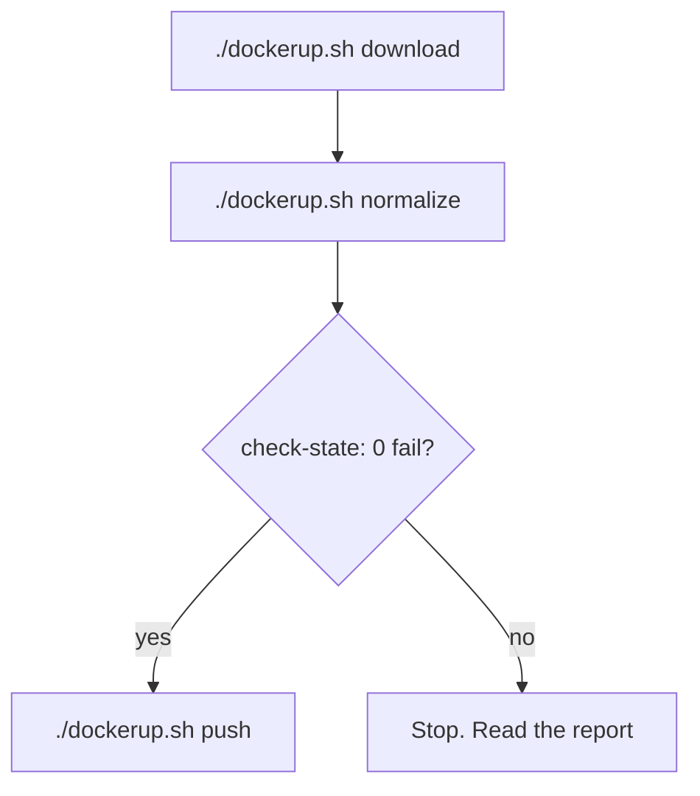
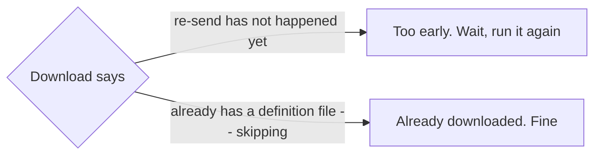
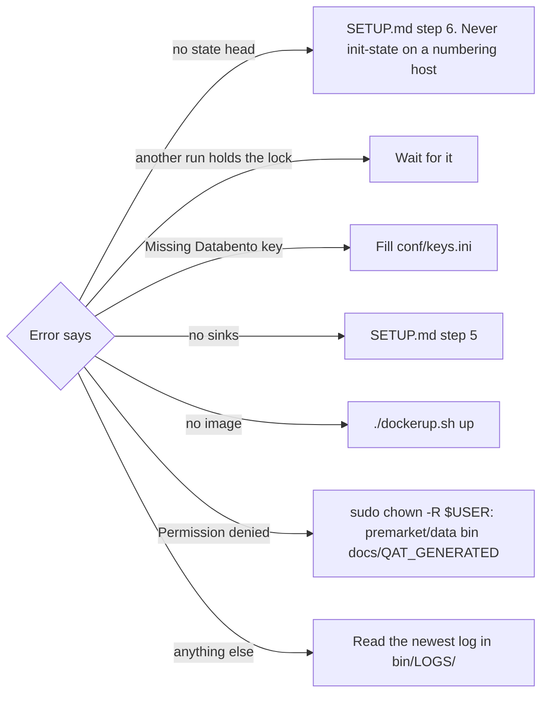

# Runbook

Every trading day, before the US open. One-time setup: [SETUP.md](SETUP.md).

```sh
cd Securities
```

## When

| | UTC | IST |
|---|---|---|
| XNAS contracts out | ~06:00 | ~11:30 |
| XCBO new listings out | ~13:00 | ~18:30 |
| **Run** | **13:05–14:00** | **18:35–19:30** |
| US open | 14:30 | 20:00 |

US standard time, from 2026-11-02. In US summer time everything is an hour earlier in both UTC and IST.

## Daily run



```sh
./dockerup.sh download      # india, xnas, xcme, xcbo
./dockerup.sh normalize     # XNAS, XCME, XCBO one at a time, then India; then check-state
./dockerup.sh push          # premarket load through every conf/sinks/<name>.ini
```

Or all three in one go:

```sh
./dockerup.sh daily
```

Each download prints `kept 50,244 for 20261102 ... newest 2026-11-02 13:00:01Z`.



## One venue

```sh
./dockerup.sh premarket xcbo --symbols-file /opt/securities/conf/symbols/XCBO.txt
./dockerup.sh normalize --venue XCBO --reason "daily XCBO again"
./dockerup.sh premarket check-state
./dockerup.sh push --date-dir 20261102
```

Paths given to `premarket` are inside the container: `conf/` is `/opt/securities/conf/`.

## Command map

| dockerup | premarket | Writes |
|----------|-----------|--------|
| `download` | `india`, `xnas`, `xcme`, `xcbo` | `premarket/data/YYYYMMDD/<MIC>/` |
| `normalize` | `normalize --venue <MIC>` for XNAS, XCME, XCBO, then XNSE XBOM XIMC; `check-state` | `premarket/data/YYYYMMDD/TRANSFORM/`, `premarket/data/_state/` |
| `push` | `load --sink <name>` for every sink | the sinks' databases, `tokenmap.<MIC>.bin` |
| `premarket ARGS` | anything | |

## Older days

A day before the first one, or a missed day. Downloads are today only (a live replay), so the day's definition file, with live instrument ids, has to be put in `premarket/data/YYYYMMDD/<MIC>/` by hand first. Then preview, and fill:

```sh
./dockerup.sh normalize --dates=20261030 --venue XCME --reason "missed day" --dry-run
./dockerup.sh normalize --dates=20261030 --venue XCME --reason "missed day"
```

Never `normalize --date-dir` an older date: it is refused.

## When something fails



```sh
ls -t bin/LOGS | head
./dockerup.sh check
```

## Cron

```cron
10 13 * * 1-5  cd /path/to/Securities && ./dockerup.sh daily >> bin/LOGS/cron.log 2>&1
```

The host's time zone; the time above is UTC. One hour earlier in US summer time.
