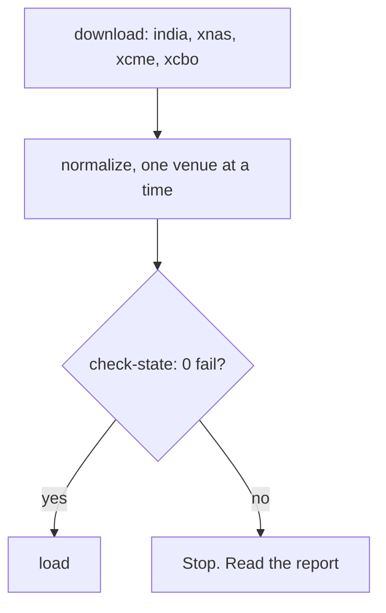
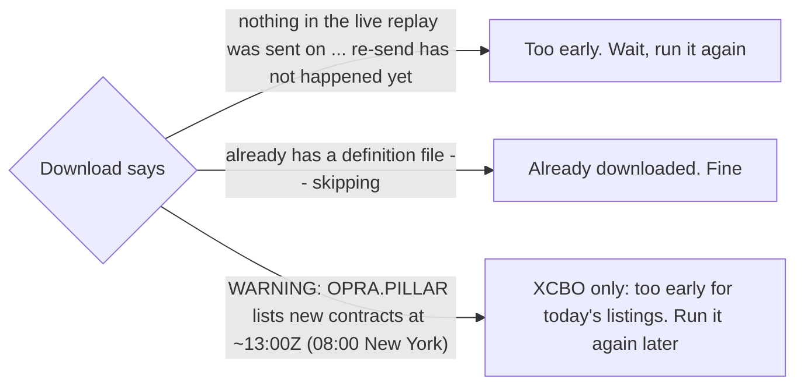
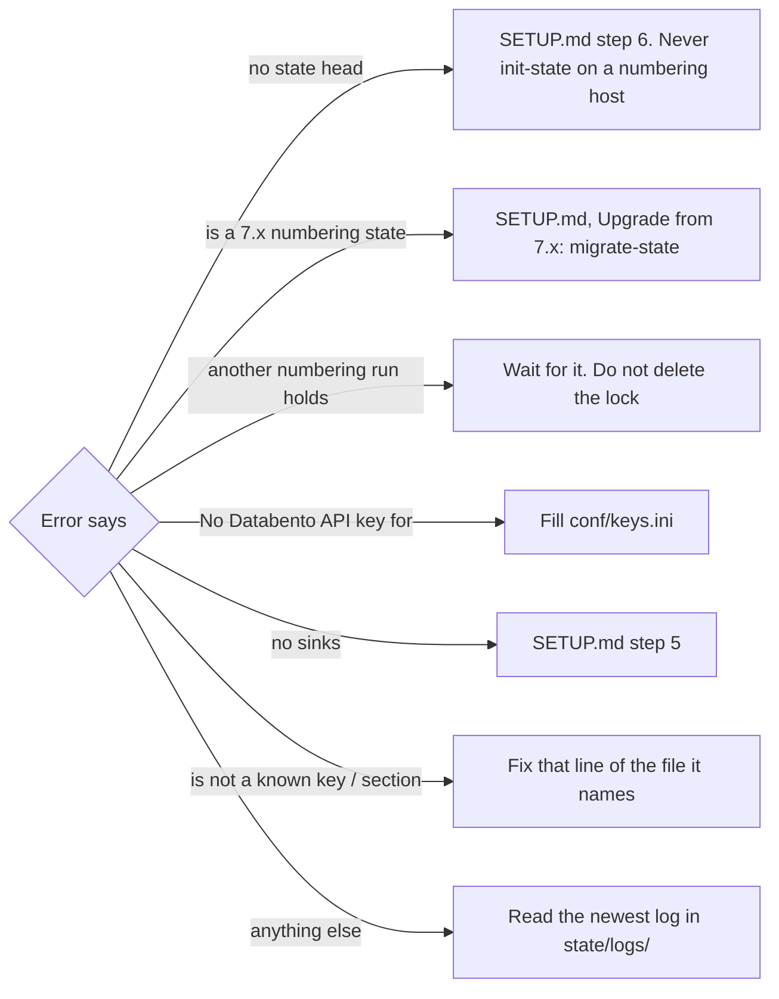

# Runbook

Every trading day, before the US open. One-time setup: [SETUP.md](SETUP.md).

```sh
PM="/opt/securities/current/bin/premarket --config=/opt/securities/conf/config.ini --keys=/opt/securities/conf/keys.ini"
```

## When

| | UTC | IST |
|---|---|---|
| XNAS contracts out | ~07:00 | ~12:30 |
| XCBO new listings out | ~13:00 | ~18:30 |
| **Run** | **13:05–14:00** | **18:35–19:30** |
| US open | 14:30 | 20:00 |

US standard time, from 2026-11-01 (XNAS's re-send landed at 06:56Z on 2026-11-03). In US summer time everything is an hour earlier in both UTC and IST. XCME's contracts are out from Sunday afternoon and can be downloaded any time.

## Daily run



```sh
$PM india
$PM xnas
$PM xcme
$PM xcbo

$PM normalize --venue XNAS --reason "daily XNAS"
$PM normalize --venue XCME --reason "daily XCME"
$PM normalize --venue XCBO --reason "daily XCBO"
$PM normalize --venue XNSE --venue XBOM --venue XIMC --reason "daily India"
$PM check-state

$PM load                  # every sink in /opt/securities/conf/sinks/
```

New contracts get token numbers in the order the venues are normalized, so keep that order. Each download prints a line like `36 sent today, newest 2026-11-03 06:55:54Z`.



## One venue

```sh
$PM xcbo
$PM normalize --venue XCBO --reason "daily XCBO again"
$PM check-state
$PM load --date-dir 20261103 --sink postgres-plugin-xcbo --sink mdf-tokenmap
```

To download a venue again, delete its file in `/opt/securities/state/data/YYYYMMDD/<MIC>/` first. Re-running `normalize` is always safe: it keeps every token it has given out.

## Older days

A day before the first one, or a missed day. Downloads are today only (a live replay), so put the day's definition file, with live instrument ids, in `/opt/securities/state/data/YYYYMMDD/<MIC>/` by hand first. Then preview, and fill:

```sh
$PM normalize --dates=20261030 --venue XCME --reason "missed day" --dry-run
$PM normalize --dates=20261030 --venue XCME --reason "missed day"
```

The fill takes a backup first, runs newest first, and ends with a quality gate (check-tokens and check-state); if the gate fails, the filled days are on disk but must not be loaded. Never `normalize --date-dir` an older date: it is refused.

## When something fails



```sh
ls -t /opt/securities/state/logs | head
$PM check-state
```

Exit status: 0 done, 1 failed (the `error:` line says why), 2 a mistake on the command line.

## Scheduling

Every command is a single process that finishes, so any scheduler runs it. The numbering state lives on this host's disk and one numbering run at a time holds its lock, so **every normalize, fill and load runs on the host that holds `state/`**. Downloads may run anywhere that writes into that same `state/data`.

### cron

The daily run as one script, which stops at the first step that fails (save it as `/opt/securities/conf/daily.sh`, `chmod 755`):

```sh
#!/bin/sh
set -eu
PM="/opt/securities/current/bin/premarket --config=/opt/securities/conf/config.ini --keys=/opt/securities/conf/keys.ini"
for v in india xnas xcme xcbo; do $PM $v; done
for v in XNAS XCME XCBO; do $PM normalize --venue $v --reason "daily $v"; done
$PM normalize --venue XNSE --venue XBOM --venue XIMC --reason "daily India"
$PM check-state
$PM load
```

```cron
# m  h  dom mon dow   the host's time zone; this is 13:05 UTC, US standard time
05 13 * * 1-5  /opt/securities/conf/daily.sh >> /opt/securities/state/logs/cron.log 2>&1
```

One hour earlier in US summer time.

### HTCondor

Vanilla universe, pinned to the machine that holds the state. One submit file per step; DAGMan chains them:

```text
# premarket-normalize.sub
universe     = vanilla
executable   = /opt/securities/current/bin/premarket
arguments    = "--config=/opt/securities/conf/config.ini --keys=/opt/securities/conf/keys.ini normalize --reason 'daily htcondor'"
requirements = (Machine == "securities-host.example")
output       = /opt/securities/state/logs/condor-normalize-$(Cluster).out
error        = /opt/securities/state/logs/condor-normalize-$(Cluster).err
log          = /opt/securities/state/logs/condor.log
queue
```

```text
# premarket-daily.dag
JOB download premarket-download.sub
JOB normalize premarket-normalize.sub
JOB check premarket-check-state.sub
JOB load premarket-load.sub
PARENT download CHILD normalize
PARENT normalize CHILD check
PARENT check CHILD load
```

`premarket-download.sub` is the same with `arguments = "... xcbo"` (one job per venue, or `queue` over `india xnas xcme xcbo`). A non-zero exit fails the node, so a failed check-state stops the load.
