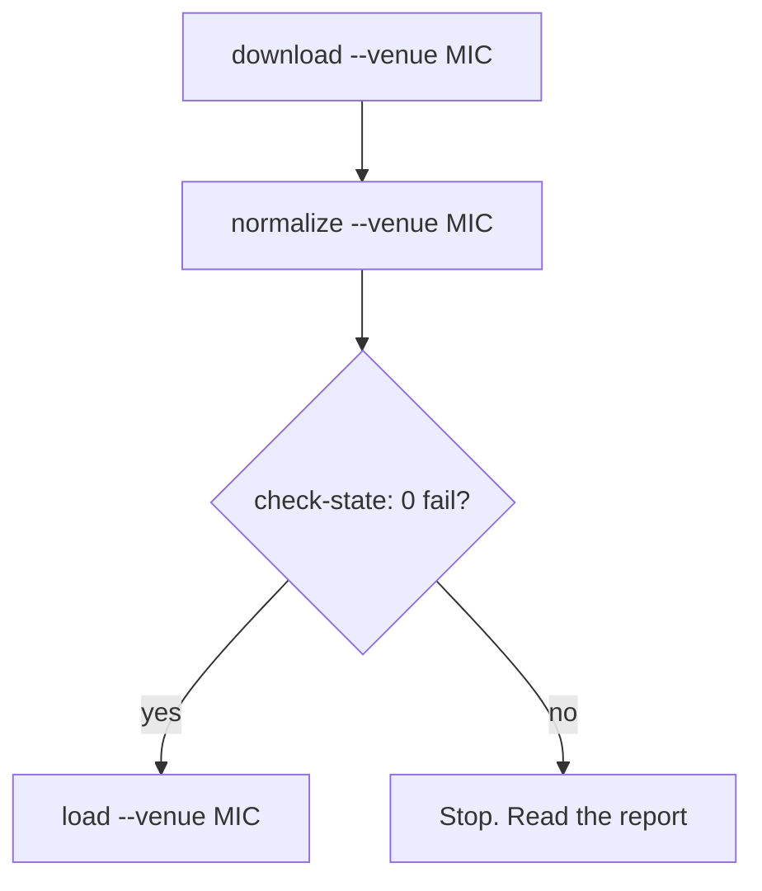
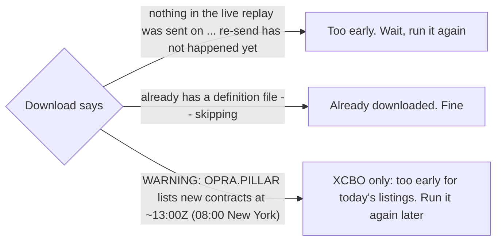
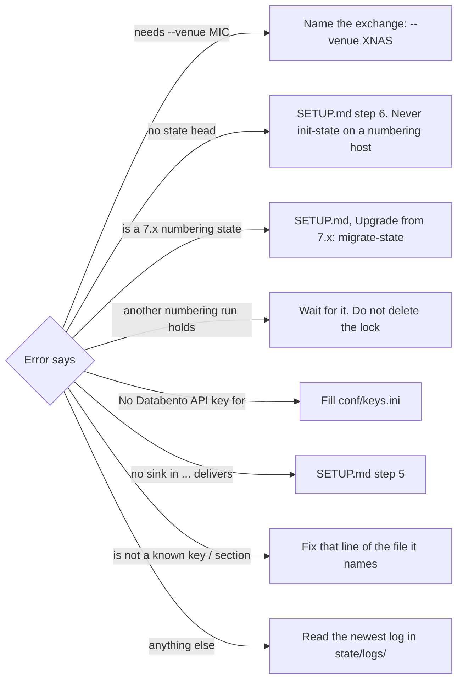

# Runbook

Every trading day, before the US open. One-time setup: [SETUP.md](SETUP.md).

```sh
PM="/opt/securities/current/bin/premarket --config=/opt/securities/conf/config.ini --keys=/opt/securities/conf/keys.ini"
```

Every run is for one exchange, named with `--venue`: XNAS, XCME, XCBO, XNSE, XBOM, XIMC. There is no run for "all of them".

## When

| | UTC | IST |
|---|---|---|
| XNAS contracts out | ~07:00 | ~12:30 |
| XCBO new listings out | ~13:00 | ~18:30 |
| **Run** | **13:05–14:00** | **18:35–19:30** |
| US open | 14:30 | 20:00 |

US standard time, from 2026-11-01 (XNAS's re-send landed at 06:56Z on 2026-11-03). In US summer time everything is an hour earlier in both UTC and IST. XCME's contracts are out from Sunday afternoon and can be downloaded any time.

## A venue's day



```sh
v=XNAS
$PM download  --venue $v
$PM normalize --venue $v --reason "daily $v"
$PM check-state
$PM load      --venue $v          # every sink in /opt/securities/conf/sinks/ that delivers $v
```

Do it for each venue, one at a time, in this order: **XNAS, XCME, XCBO, XNSE, XBOM, XIMC**. New contracts get token numbers in the order the venues are normalized, so keep it. A venue that fails stops only its own day; the next venue runs as usual.

- `download` fetches the venue's own source: the Databento live replay for XNAS, XCME and XCBO, the Fyers symbol master for XNSE, XBOM and XIMC. A venue on the `nse` or `mcx` feed has nothing to download: the BOD process places its file.
- `load` pushes only that venue: its `postgres-plugin-<mic>` sink, `mdf-tokenmap` for a Databento venue, and `clickhouse-normal`, which replaces that venue's rows in the day's tables and leaves the other venues' rows alone. Name sinks with `--sink NAME` to push fewer.

Each Databento download prints a line like `36 sent today, newest 2026-11-03 06:55:54Z`.



To download a venue again, delete its file in `/opt/securities/state/data/YYYYMMDD/<MIC>/` first. Re-running `normalize` is always safe: it keeps every token it has given out. To push an older day again, add `--date-dir YYYYMMDD` to `load`.

## Older days

A day before the first one, or a missed day. Downloads are today only (a live replay), so put the day's definition file, with live instrument ids, in `/opt/securities/state/data/YYYYMMDD/<MIC>/` by hand first. Then preview, and fill:

```sh
$PM normalize --venue XCME --dates=20261030 --reason "missed day" --dry-run
$PM normalize --venue XCME --dates=20261030 --reason "missed day"
```

The fill takes a backup first, runs newest first, and ends with a quality gate (check-tokens for that venue, and check-state); if the gate fails, the filled days are on disk but must not be loaded. Never `normalize --date-dir` an older date: it is refused.

## When something fails



```sh
ls -t /opt/securities/state/logs | head      # download-XNAS_..., normalize-XNAS_..., load-XNAS_...
$PM check-state
$PM check-tokens --venue XNAS
```

Exit status: 0 done, 1 failed (the `error:` line says why), 2 a mistake on the command line.

## Scheduling

Every command is a single process that finishes, so any scheduler runs it. The numbering state lives on this host's disk and one numbering run at a time holds its lock, so **every normalize, fill and load runs on the host that holds `state/`, one at a time**. Downloads may run anywhere that writes into that same `state/data`.

### cron

A venue's day as one script, which stops at the first step that fails (save it as `/opt/securities/conf/day.sh`, `chmod 755`):

```sh
#!/bin/sh
# day.sh MIC: one exchange's day
set -eu
v=$1
PM="/opt/securities/current/bin/premarket --config=/opt/securities/conf/config.ini --keys=/opt/securities/conf/keys.ini"
$PM download  --venue $v
$PM normalize --venue $v --reason "daily $v"
$PM check-state
$PM load      --venue $v
```

```cron
# m  h  dom mon dow   the host's time zone; this is 13:05 UTC, US standard time
05 13 * * 1-5  for v in XNAS XCME XCBO XNSE XBOM XIMC; do /opt/securities/conf/day.sh $v >> /opt/securities/state/logs/cron-$v.log 2>&1; done
```

One hour earlier in US summer time. The venues run one after another, so no two hold the state at once, and one that fails does not stop the rest.

### HTCondor

Vanilla universe, pinned to the machine that holds the state. One submit file per command, each taking the venue as `$(venue)`:

```text
# normalize.sub (download.sub and load.sub are the same with `download --venue $(venue)` and `load --venue $(venue)`;
# check-state.sub runs `check-state`)
universe     = vanilla
executable   = /opt/securities/current/bin/premarket
arguments    = "--config=/opt/securities/conf/config.ini --keys=/opt/securities/conf/keys.ini normalize --venue $(venue) --reason 'daily htcondor'"
requirements = (Machine == "securities-host.example")
output       = /opt/securities/state/logs/condor-normalize-$(venue)-$(Cluster).out
error        = /opt/securities/state/logs/condor-normalize-$(venue)-$(Cluster).err
log          = /opt/securities/state/logs/condor.log
queue
```

DAGMan chains a venue's day; repeat the block for each venue. The `state` category lets one numbering or load job run at a time:

```text
# premarket-daily.dag
JOB dl-XNAS download.sub
JOB nm-XNAS normalize.sub
JOB cs-XNAS check-state.sub
JOB ld-XNAS load.sub
VARS dl-XNAS venue="XNAS"
VARS nm-XNAS venue="XNAS"
VARS cs-XNAS venue="XNAS"
VARS ld-XNAS venue="XNAS"
PARENT dl-XNAS CHILD nm-XNAS
PARENT nm-XNAS CHILD cs-XNAS
PARENT cs-XNAS CHILD ld-XNAS
CATEGORY nm-XNAS state
CATEGORY ld-XNAS state
MAXJOBS state 1
```

A non-zero exit fails the node, so a failed check-state stops that venue's load and no other venue's.
