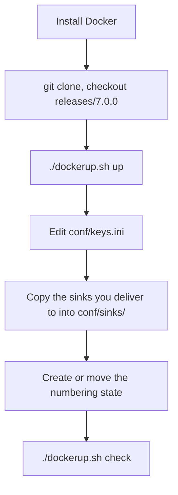
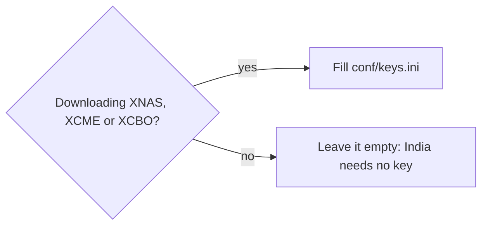
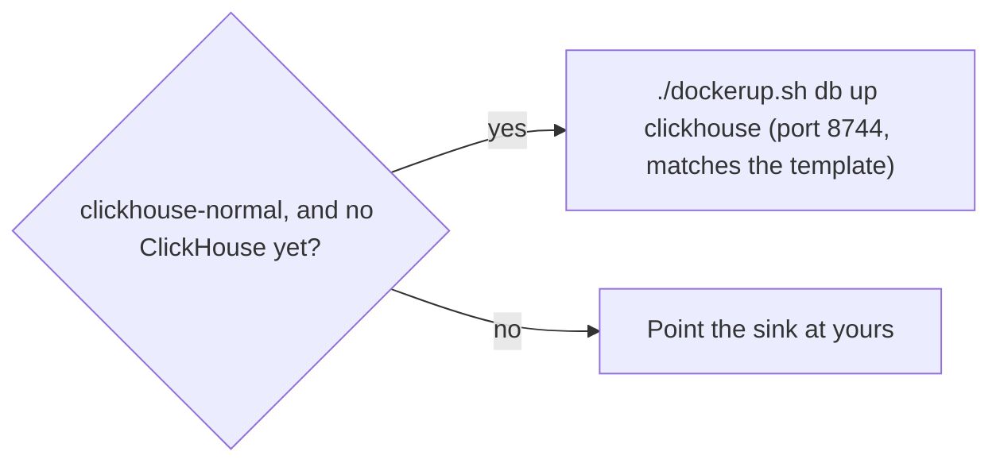
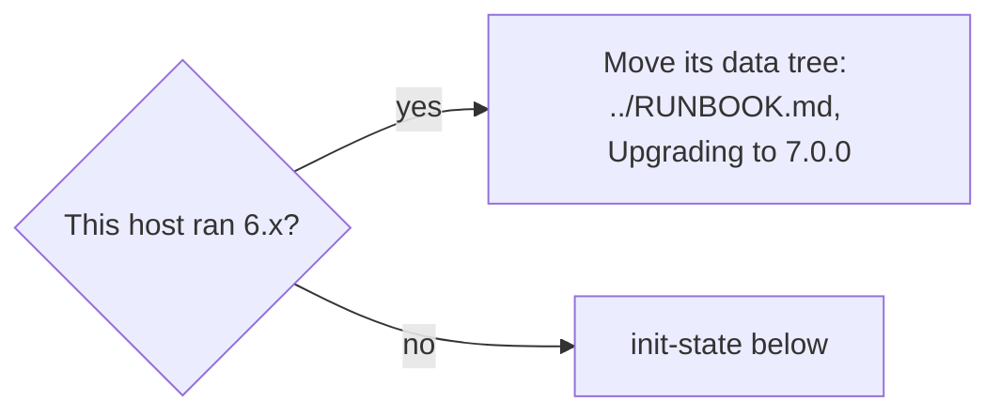
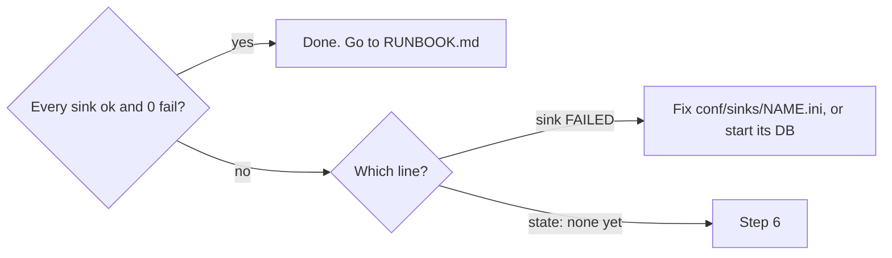

# Setup

One time per host. Builds the image from this checkout and sets up its config and numbering state. Daily commands are in [RUNBOOK.md](RUNBOOK.md).



## 1. Install Docker

```sh
sudo apt-get install -y docker.io docker-compose-v2
sudo usermod -aG docker $USER      # then log out and back in
docker compose version
```

## 2. Get the code

```sh
git clone git@github.com:dvygo/Securities.git
cd Securities
git checkout releases/7.0.0
```

## 3. Build

```sh
./dockerup.sh up
```

This builds `securities:latest` from `docker/Dockerfile` (unit tests, then the Nuitka compile; a few minutes), and creates `conf/config.ini` and `conf/keys.ini` from the `.example` files. It starts no database.

## 4. Databento keys



`conf/keys.ini`:

```ini
[production]
key_XNAS=db-...
key_XCBO=db-...
key_XCME=db-...
```

What gets downloaded is `conf/symbols/<MIC>.txt`: 36 XNAS stocks; SPY, SPX and SPXW options on XCBO; the XCME roots. Delete a file to take every symbol of that venue.

## 5. Sinks

`./dockerup.sh push` delivers through every `conf/sinks/<name>.ini`. Copy the ones you need and edit them:

```sh
cp conf/sinks/postgres-plugin-xnas.ini.example conf/sinks/postgres-plugin-xnas.ini
cp conf/sinks/postgres-plugin-xcme.ini.example conf/sinks/postgres-plugin-xcme.ini
cp conf/sinks/postgres-plugin-xcbo.ini.example conf/sinks/postgres-plugin-xcbo.ini
cp conf/sinks/mdf-tokenmap.ini.example conf/sinks/mdf-tokenmap.ini
```

| Sink | Delivers | Set |
|------|----------|-----|
| `postgres-plugin-<mic>` | that market's rows to the legacy symbol master, upserted on `(token, trade_date)` | `database_url`, `schema`, `table`; `venue_id` must equal `config.ini`'s |
| `mdf-tokenmap` | `tokenmap.<MIC>.bin` for MDF | `dir`: empty = the day's tree; MDF's `config/cpp-vendor-databento/` to deliver in place |
| `clickhouse-normal` | every venue, every column: `contracts_YYYYMMDD`, `baskets_YYYYMMDD`, `contracts`, `baskets` | `host`, `port`, `database`, `username`, `password` |



## 6. Numbering state

`normalize` and `push` refuse to run without it: `premarket/data/_state/`.



```sh
./dockerup.sh premarket init-state --dry-run --reason "first run on this host"
./dockerup.sh premarket init-state --reason "first run on this host"
```

Never run `init-state` on a host that already numbers: it restarts the tokens. It refuses if a state exists, and refuses if a 6.x state is still under `v6-python/`.

## 7. Check

```sh
./dockerup.sh check
```

```text
config:    conf/config.ini
config:    conf/keys.ini
databento: [production] keys for: XNAS XCBO XCME
symbols:   XCBO.txt XCME.txt XNAS.txt
sink:      mdf-tokenmap (mdf-tokenmap): ok (the day tree)
sink:      postgres-plugin-xcbo (postgres-plugin): ok (127.0.0.1:6006/plugindb?sslmode=disable)
...
7 check(s): 7 pass, 0 fail, 0 warn
```



## After a code change

```sh
git pull --ff-only
./dockerup.sh up      # rebuilds the image; conf/ and premarket/data/ stay
```

## Where things are

| Path | What |
|------|------|
| `conf/` | `config.ini`, `keys.ini`, `sinks/*.ini`, `symbols/*.txt` (read-only in the container) |
| `premarket/data/YYYYMMDD/` | raw downloads, `TRANSFORM/normalized/`, `TRANSFORM/plugin/`, `TRANSFORM/manifests/` |
| `premarket/data/_state/` | the numbering state: back it up, never delete it |
| `constituents/contracts/YYYYMMDD/` | basket contracts |
| `bin/LOGS/` | one log per run |
| `docs/QAT_GENERATED/` | check-tokens, check-lineage, check-state reports |
| `docker/Dockerfile` | the image |
| `docker/contract-clickhouse/`, `docker/contract-postgres/` | bundled databases, started only on request |

Without Docker (venv): the [README](../README.md#quick-start).
