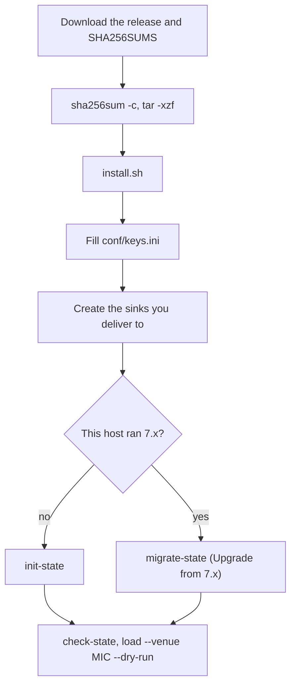

# Setup

One time per host: install a release, give it its keys and sinks, and create (or migrate) the numbering state. Daily commands are in [RUNBOOK.md](RUNBOOK.md).



## 1. The host

Ubuntu 22.04 on x86_64, with `tzdata` (in every stock install). Nothing else: premarket is one program and the libraries it ships with. No Docker, no Python. It needs outbound HTTPS to `public.fyers.in` (India) and Databento's live gateways, TCP 13000 (US).

Install it with `sudo`, always: `install.sh` refuses to run any other way. Run premarket itself as the ordinary account that owns `conf/` and `state/`.

## 2. Install

Download `securities_8.1.0_ubuntu22.04_amd64.tar.gz` and `SHA256SUMS` from the [release page](https://github.com/deshik-ux/securities/releases/tag/v8.1.0). With `gh`:

```sh
gh release download v8.1.0 -R deshik-ux/securities -p 'securities_8.1.0_ubuntu22.04_amd64.tar.gz' -p SHA256SUMS
```

Then, from the account that will run premarket, into the directory you choose (`/srv/securities` here; any new or empty directory will do):

```sh
sha256sum -c SHA256SUMS --ignore-missing        # must say OK
tar -xzf securities_8.1.0_ubuntu22.04_amd64.tar.gz
sudo securities_8.1.0_ubuntu22.04_amd64/install.sh --prefix /srv/securities
```

`--prefix` is required; there is no default directory. `install.sh` fails loudly, and changes nothing, when it is not run through sudo, when the directory holds something other than a premarket install, or while a premarket run holds the numbering lock. It lays out the directory like this:

| Path | What | Owner, mode |
|------|------|-------------|
| `bin/premarket` | what you run: a launcher that sets `LD_LIBRARY_PATH=<dir>/libs` and starts `libexec/premarket` | root, 0755 |
| `libexec/premarket` | the program | root, 0755 |
| `libs/` | every library the program needs beyond glibc: DuckDB, OpenSSL, zlib, zstd, libstdc++, libgcc_s | root, 0644 |
| `share/` | the config, keys, sink and symbol templates; the basket definitions | root |
| `conf/`, `state/` | your configuration and everything premarket writes; created when missing, never overwritten | the account that ran sudo, or `--owner USER` |

`libexec/premarket` has no built-in library path: started without `bin/premarket` it stops at once with `libduckdb.so: cannot open shared object file`. Every command takes the config and keys by full path:

```sh
DIR=/srv/securities                     # the directory you installed into
PM="$DIR/bin/premarket --config=$DIR/conf/config.ini --keys=$DIR/conf/keys.ini"
$PM --version
```

## 3. Databento keys

`$DIR/conf/keys.ini`, mode 0600 (install.sh sets it):

```ini
[databento]
XNAS = db-...
XCBO = db-...
XCME = db-...
```

Only `download` reads it, and only the key of the venue it downloads. The India venues (Fyers) need no key.

## 4. What to download

`$DIR/conf/symbols/<MIC>.txt` is what each US download asks Databento for: 36 XNAS stocks; SPY, SPX and SPXW options on XCBO; the XCME roots. One symbol per line. To take every instrument of a venue, empty its `symbols =` in `config.ini`.

`config.ini` needs no other change on a new host: its venue ids are the ones every existing host numbers under. Every key it accepts is in the file, with what it means.

## 5. Sinks

`load --venue MIC` delivers that venue through the `<name>.ini` files in `$DIR/conf/sinks/` that carry it: `clickhouse-normal` for every venue, `postgres-plugin-<mic>` for its own market, `mdf-tokenmap` for a Databento venue. Copy the templates you need and fill them in:

```sh
cd $DIR/conf/sinks
cp postgres-plugin-xnas.ini.example postgres-plugin-xnas.ini
cp postgres-plugin-xcme.ini.example postgres-plugin-xcme.ini
cp postgres-plugin-xcbo.ini.example postgres-plugin-xcbo.ini
cp mdf-tokenmap.ini.example mdf-tokenmap.ini
chmod 600 *.ini
```

| Sink | Delivers | Set |
|------|----------|-----|
| `postgres-plugin-<mic>` | that market's rows to the legacy symbol master, upserted on `(token, trade_date)` | `database_url`, `schema`, `table`; `venue_id` must equal `config.ini`'s |
| `mdf-tokenmap` | `tokenmap.<MIC>.bin` for MDF | `dir`: empty = the day's tree; the absolute path of MDF's `config/cpp-vendor-databento/` to deliver in place |
| `clickhouse-normal` | every venue, every column: `contracts_YYYYMMDD`, `baskets_YYYYMMDD`, `contracts`, `baskets` | `host`, `port` (HTTP), `database`, `username`, `password`, `secure` (0/1) |

A key a sink type does not know is an error, so a typo is caught on the first `load --dry-run`. `clickhouse-normal` replaces only the loaded venue's rows in the day's tables, so loading the venues one by one builds the whole day.

## 6. Numbering state

`normalize` and `load` refuse to run without it: `$DIR/state/data/_state/`.

- **A new host** creates it once:

  ```sh
  $PM init-state --dry-run --reason "first run on this host"
  $PM init-state --reason "first run on this host"
  ```

- **A host that ran 7.x** keeps its state and migrates it: [Upgrade from 7.x](#upgrade-from-7x).

Never run `init-state` on a host that already numbers: it restarts the tokens. It refuses if a state exists.

## 7. Check

```sh
$PM check-state                        # must end with 0 fail
for v in XNAS XCME XCBO XNSE XBOM XIMC; do $PM load --venue $v --dry-run; done   # reads the sinks, connects to nothing
```

## Upgrade from 7.x

Once per host, after the day's run and never between its steps. 8.x continues the same tokens from the same data tree: nothing is renumbered.

1. **Install 8.1.0** (step 2). The 7.x install stays where it is until you remove it.
2. **config.ini.** Start from the one install.sh created and carry over from the 7.x file:
   - `[paths]`: point at the 7.x tree, by absolute path. A `dockerup.sh` host kept it in `state/` beside `dockerup.sh` (`SECURITIES_STATE_DIR`): `data_dir = <state>/data`, `contracts_dir = <state>/contracts`, `logs_dir = <state>/logs`, `reports_dir = <state>/qat`.
   - each `[EXCHANGE:<MIC>]` becomes `[venue.<MIC>]` with the same `feed`, `enabled` and **`venue_id`** (a different id is refused), and for Databento venues `dataset` and `stype_in`. `symbols` is new: the absolute path of the list that 7.x took as `--symbols-file`. `schema`, `stype_in_all_symbols`, `all_symbols_default` and `hist_*` are gone; leave them out.
   - `[baskets] enabled` and `[fyers]` (`base_url`, `user_agent`, `timeout_sec`, `retries`, `retry_delay_sec`) carry over as they are. `[databento]` (`live_*`, `max_maps`) and `[postgres]` are gone, and so are `bin_dir` and the relative paths of 7.x's `[paths]`.
3. **keys.ini.** `[production]` `key_XNAS = db-...` becomes `[databento]` `XNAS = db-...`, and so on. `[development]` and `DATABENTO_ENV` are gone: a host has one key per venue. To convert without showing the keys (`OLD` = the 7.x `conf/`):

   ```sh
   { echo '[databento]'; sed -n '/^\[production\]/,/^\[/s/^key_\(X[A-Z]*\) *= */\1 = /p' "$OLD/keys.ini"; } > $DIR/conf/keys.ini
   chmod 600 $DIR/conf/keys.ini
   grep -c '^X... = db-' $DIR/conf/keys.ini     # 3 when all three venues have a key
   ```
4. **Sinks.** Copy each 7.x `<name>.ini` into `$DIR/conf/sinks/`. Remove `tcp_port`; write `secure` as `0` or `1`. Anything that came from a `PREMARKET_SINK_<NAME>_<KEY>` variable goes into the file: 8.x reads no environment.
5. **Migrate the state.** It takes a backup first, rewrites the head, every venue header and every `_sequence.json` as v8, and verifies that no token, free list or snapshot changed:

   ```sh
   $PM migrate-state --dry-run --reason "upgrade to 8.x"
   $PM migrate-state --reason "upgrade to 8.x"
   $PM check-state                                   # must end with 0 fail
   ```

6. **Scheduling.** Replace the 7.x cron lines with 8.x's ([RUNBOOK.md](RUNBOOK.md#scheduling)). From the next run on, `normalize` carries every venue on from the state as 7.x left it.

## Upgrade from 8.0.0

8.0.0 installed into `<prefix>/8.0.0/` behind a `<prefix>/current` link. Install 8.1.0 into the same prefix, after the day's run:

```sh
sudo securities_8.1.0_ubuntu22.04_amd64/install.sh --prefix /opt/securities    # the prefix 8.0.0 used
```

It keeps `conf/` and `state/` and their owner, removes `current` and the `8.0.0/` directory, and changes the one line of `config.ini` that named them: `baskets_dir` becomes `<prefix>/share/baskets` (the old file is kept as `config.ini.8.0`). Then change every cron line, script or submit file from `<prefix>/current/bin/premarket` to `<prefix>/bin/premarket`: the old path no longer exists, so anything left on it fails at once rather than running 8.0.0. The numbering state is the same v8: no migration.

## Upgrade to a later 8.x

The same command with the newer tarball and the same `--prefix`. `bin/`, `libexec/`, `libs/` and `share/` are replaced; `conf/` and `state/` are left as they are.

## Roll back

**To an earlier 8.1 or later release:** run that release's `install.sh` with the same `--prefix`.

**To 7.x**, only before 8.x has numbered a day: restore the backup `migrate-state` took, from the data directory, and point the 7.x cron lines back:

```sh
cd $DIR/state/data                      # your data_dir
ls -t _state/backups/ | head -3         # the *-migrate-*.tar.gz one
tar -xzf _state/backups/<run_id>.tar.gz
```

Once 8.x has numbered a day, its headers are v8 and 7.x refuses them. Fix forward instead.

## Where things are

| Path | What |
|------|------|
| `$DIR/bin/premarket` | what you run; `$DIR/libexec/premarket` is the program, `$DIR/libs/` its libraries |
| `$DIR/share/` | templates, baskets; `$DIR/VERSION`, `BUILD_SHA`, `THIRD_PARTY_NOTICES.txt` beside it |
| `$DIR/conf/config.ini` | venues, paths, Fyers settings |
| `$DIR/conf/keys.ini` | Databento keys (0600) |
| `$DIR/conf/sinks/<name>.ini` | one per delivery; `load --venue MIC` uses every one that carries the venue |
| `$DIR/conf/symbols/<MIC>.txt` | what each US download asks for |
| `$DIR/state/data/YYYYMMDD/` | downloads, `TRANSFORM/normalized/`, `TRANSFORM/plugin/`, `TRANSFORM/manifests/` |
| `$DIR/state/data/_state/` | the numbering state: back it up, never delete it |
| `$DIR/state/contracts/YYYYMMDD/` | basket contracts |
| `$DIR/state/logs/` | one log per run |
| `$DIR/state/reports/` | the latest check-tokens, check-lineage and check-state reports |

## Security

`keys.ini` and the sink files hold credentials: keep them 0600, owned by the account that runs premarket, and never copy them into a repository. premarket reads them from the paths you give it and from nowhere else; it reads no environment variable.

The program files are root's, so the account that runs premarket cannot change them. premarket uses the OpenSSL, zlib and zstd in `libs/`, not the host's: an Ubuntu security update to those reaches premarket with the next release, not with `apt upgrade`.
