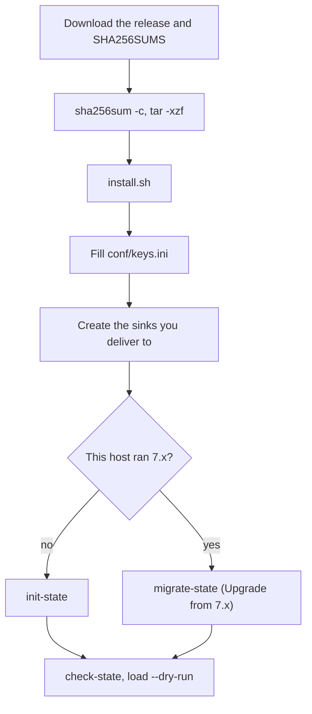

# Setup

One time per host: install a release, give it its keys and sinks, and create (or migrate) the numbering state. Daily commands are in [RUNBOOK.md](RUNBOOK.md).



## 1. The host

Ubuntu 22.04 on x86_64, with `tzdata` (in every stock install). Nothing else: premarket is one binary and the DuckDB library beside it. No Docker, no Python. It needs outbound HTTPS to `public.fyers.in` (India) and Databento's live gateways, TCP 13000 (US).

Run it as an ordinary user. Only `install.sh` may need `sudo`, to create `/opt/securities`.

## 2. Install

Download `securities_8.0.0_ubuntu22.04_amd64.tar.gz` and `SHA256SUMS` from the release page: [GitHub](https://github.com/deshik-ux/securities/releases/tag/v8.0.0), or the LAN GitLab, http://192.168.1.15:8929/deshik-ux/securities/-/releases/v8.0.0. With `gh`:

```sh
gh release download v8.0.0 -R deshik-ux/securities -p 'securities_8.0.0_ubuntu22.04_amd64.tar.gz' -p SHA256SUMS
```

Then:

```sh
sha256sum -c SHA256SUMS --ignore-missing        # must say OK
tar -xzf securities_8.0.0_ubuntu22.04_amd64.tar.gz
sudo securities_8.0.0_ubuntu22.04_amd64/install.sh --prefix /opt/securities --owner "$USER"
```

`install.sh` copies the release to `/opt/securities/8.0.0/`, points `/opt/securities/current` at it, and creates what is missing in `/opt/securities/conf/` and `/opt/securities/state/`. It never overwrites a file you have edited. Every command takes the config and keys by full path:

```sh
PM="/opt/securities/current/bin/premarket --config=/opt/securities/conf/config.ini --keys=/opt/securities/conf/keys.ini"
$PM --version
```

## 3. Databento keys

`/opt/securities/conf/keys.ini`, mode 0600 (install.sh sets it):

```ini
[databento]
XNAS = db-...
XCBO = db-...
XCME = db-...
```

Only the downloads read it, and only the venue they download. India needs no key: leave the file as it is if you only run `india`.

## 4. What to download

`/opt/securities/conf/symbols/<MIC>.txt` is what each US download asks Databento for: 36 XNAS stocks; SPY, SPX and SPXW options on XCBO; the XCME roots. One symbol per line. To take every instrument of a venue, empty its `symbols =` in `config.ini`.

`config.ini` needs no other change on a new host: its venue ids are the ones every existing host numbers under. Every key it accepts is in the file, with what it means.

## 5. Sinks

`load` delivers through every `<name>.ini` in `/opt/securities/conf/sinks/`. Copy the templates you need and fill them in:

```sh
cd /opt/securities/conf/sinks
cp postgres-plugin-xnas.ini.example postgres-plugin-xnas.ini
cp postgres-plugin-xcme.ini.example postgres-plugin-xcme.ini
cp postgres-plugin-xcbo.ini.example postgres-plugin-xcbo.ini
cp mdf-tokenmap.ini.example mdf-tokenmap.ini
chmod 600 *.ini
```

| Sink | Delivers | Set |
|------|----------|-----|
| `postgres-plugin-<mic>` | that market's rows to the legacy symbol master, upserted on `(token, trade_date)` | `database_url`, `schema`, `table`; `venue_id` must equal `config.ini`'s |
| `mdf-tokenmap` | `tokenmap.<MIC>.bin` for MDF | `dir`: empty = the day's tree; the absolute path of MDF's `config/cpp-vendor-databento/` to deliver in place |
| `clickhouse-normal` | every venue, every column: `contracts_YYYYMMDD`, `baskets_YYYYMMDD`, `contracts`, `baskets` | `host`, `port` (HTTP), `database`, `username`, `password`, `secure` (0/1) |

A key a sink type does not know is an error, so a typo is caught on the first `load --dry-run`.

## 6. Numbering state

`normalize` and `load` refuse to run without it: `/opt/securities/state/data/_state/`.

- **A new host** creates it once:

  ```sh
  $PM init-state --dry-run --reason "first run on this host"
  $PM init-state --reason "first run on this host"
  ```

- **A host that ran 7.x** keeps its state and migrates it: [Upgrade from 7.x](#upgrade-from-7x).

Never run `init-state` on a host that already numbers: it restarts the tokens. It refuses if a state exists.

## 7. Check

```sh
$PM check-state          # must end with 0 fail
$PM load --dry-run       # reads every sink, connects to nothing
```

## Upgrade from 7.x

Once per host, after the day's run and never between its steps. 8.0.0 continues the same tokens from the same data tree: nothing is renumbered.

1. **Install 8.0.0** (step 2). The 7.x install stays where it is until you remove it.
2. **config.ini.** Start from the one install.sh created and carry over from the 7.x file:
   - `[paths]`: point at the 7.x tree, by absolute path. A `dockerup.sh` host kept it in `state/` beside `dockerup.sh` (`SECURITIES_STATE_DIR`): `data_dir = <state>/data`, `contracts_dir = <state>/contracts`, `logs_dir = <state>/logs`, `reports_dir = <state>/qat`.
   - each `[EXCHANGE:<MIC>]` becomes `[venue.<MIC>]` with the same `feed`, `enabled` and **`venue_id`** (a different id is refused), and for Databento venues `dataset` and `stype_in`. `symbols` is new: the absolute path of the list that 7.x took as `--symbols-file`. `schema`, `stype_in_all_symbols`, `all_symbols_default` and `hist_*` are gone; leave them out.
   - `[baskets] enabled` and `[fyers]` (`base_url`, `user_agent`, `timeout_sec`, `retries`, `retry_delay_sec`) carry over as they are. `[databento]` (`live_*`, `max_maps`) and `[postgres]` are gone, and so are `bin_dir` and the relative paths of 7.x's `[paths]`.
3. **keys.ini.** `[production]` `key_XNAS = db-...` becomes `[databento]` `XNAS = db-...`, and so on. `[development]` and `DATABENTO_ENV` are gone: a host has one key per venue. To convert without showing the keys (`OLD` = the 7.x `conf/`):

   ```sh
   { echo '[databento]'; sed -n '/^\[production\]/,/^\[/s/^key_\(X[A-Z]*\) *= */\1 = /p' "$OLD/keys.ini"; } > /opt/securities/conf/keys.ini
   chmod 600 /opt/securities/conf/keys.ini
   grep -c '^X... = db-' /opt/securities/conf/keys.ini     # 3 when all three venues have a key
   ```
4. **Sinks.** Copy each 7.x `<name>.ini` into `/opt/securities/conf/sinks/`. Remove `tcp_port`; write `secure` as `0` or `1`. Anything that came from a `PREMARKET_SINK_<NAME>_<KEY>` variable goes into the file: 8.0.0 reads no environment.
5. **Migrate the state.** It takes a backup first, rewrites the head, every venue header and every `_sequence.json` as v8, and verifies that no token, free list or snapshot changed:

   ```sh
   $PM migrate-state --dry-run --reason "upgrade to 8.0.0"
   $PM migrate-state --reason "upgrade to 8.0.0"
   $PM check-state                                   # must end with 0 fail
   ```

6. **Scheduling.** Replace the 7.x cron lines with 8.0.0's ([RUNBOOK.md](RUNBOOK.md#scheduling)). From the next run on, `normalize` carries every venue on from the state as 7.x left it.

## Roll back

**To the previous 8.x release:**

```sh
sudo ln -sfn 8.0.0 /opt/securities/.current.new && sudo mv -T /opt/securities/.current.new /opt/securities/current
```

**To 7.x**, only before 8.0.0 has numbered a day: restore the backup `migrate-state` took, from the data directory, and point the 7.x cron lines back:

```sh
cd /opt/securities/state/data           # your data_dir
ls -t _state/backups/ | head -3         # the *-migrate-*.tar.gz one
tar -xzf _state/backups/<run_id>.tar.gz
```

Once 8.0.0 has numbered a day, its headers are v8 and 7.x refuses them. Fix forward instead.

## Where things are

| Path | What |
|------|------|
| `/opt/securities/current/` | the release in use: `bin/premarket`, `lib/libduckdb.so`, `share/` (templates, baskets), `THIRD_PARTY_NOTICES.txt` |
| `/opt/securities/conf/config.ini` | venues, paths, Fyers settings |
| `/opt/securities/conf/keys.ini` | Databento keys (0600) |
| `/opt/securities/conf/sinks/<name>.ini` | one per delivery; `load` uses every one present |
| `/opt/securities/conf/symbols/<MIC>.txt` | what each US download asks for |
| `/opt/securities/state/data/YYYYMMDD/` | downloads, `TRANSFORM/normalized/`, `TRANSFORM/plugin/`, `TRANSFORM/manifests/` |
| `/opt/securities/state/data/_state/` | the numbering state: back it up, never delete it |
| `/opt/securities/state/contracts/YYYYMMDD/` | basket contracts |
| `/opt/securities/state/logs/` | one log per run |
| `/opt/securities/state/reports/` | the latest check-tokens, check-lineage and check-state reports |

## Security

`keys.ini` and the sink files hold credentials: keep them 0600, owned by the account that runs premarket, and never copy them into a repository. premarket reads them from the paths you give it and from nowhere else; it reads no environment variable.
